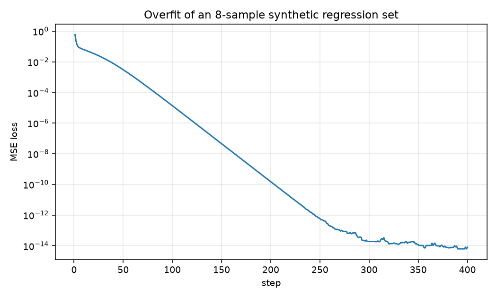
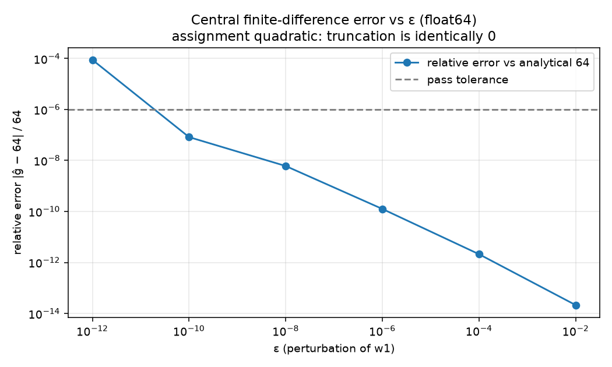
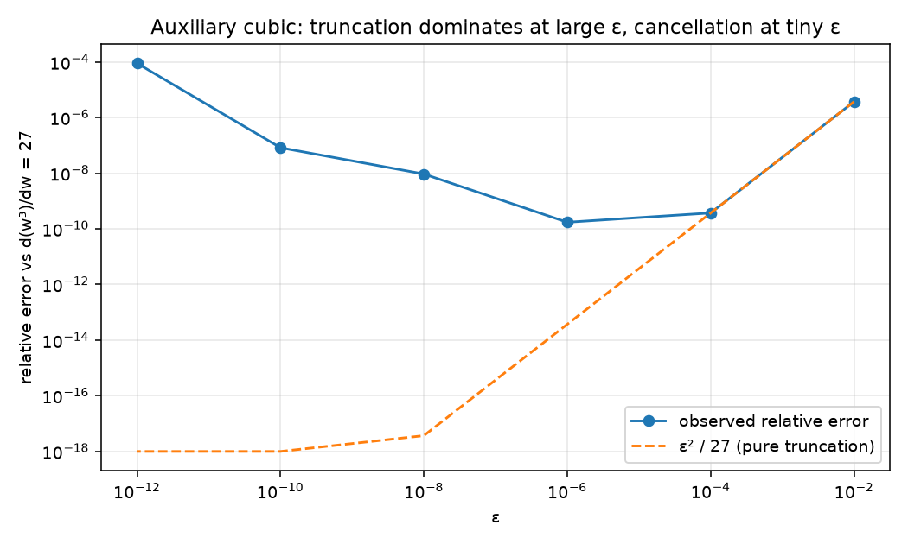
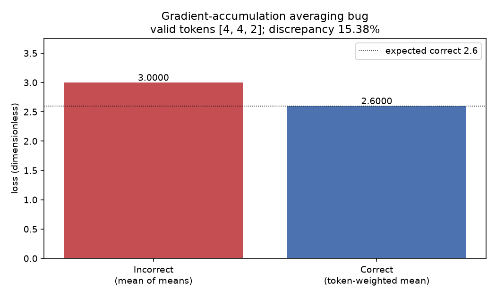
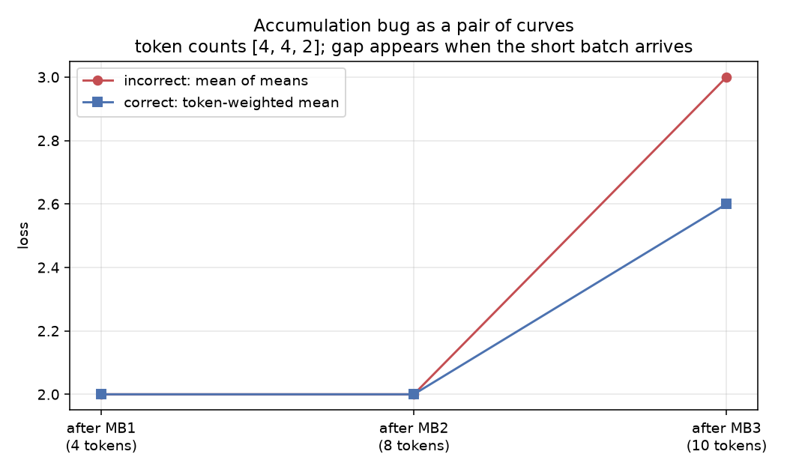
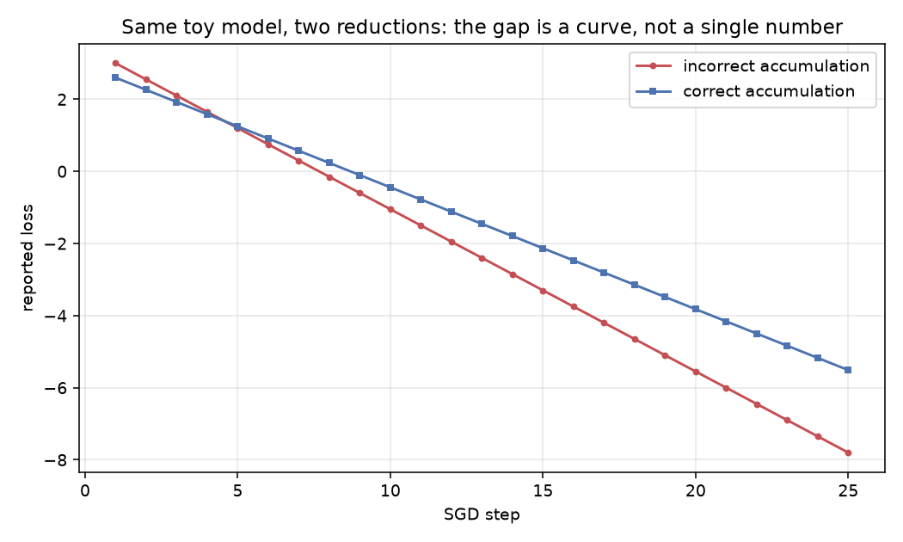
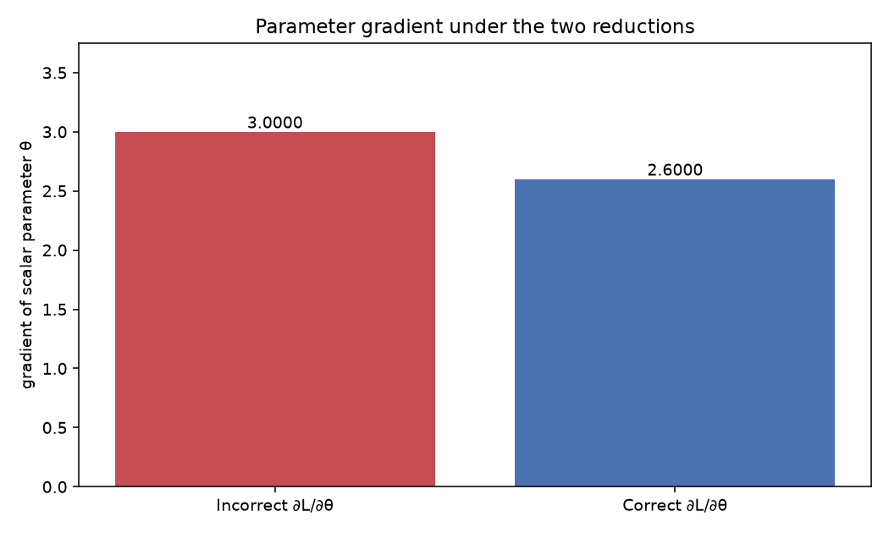
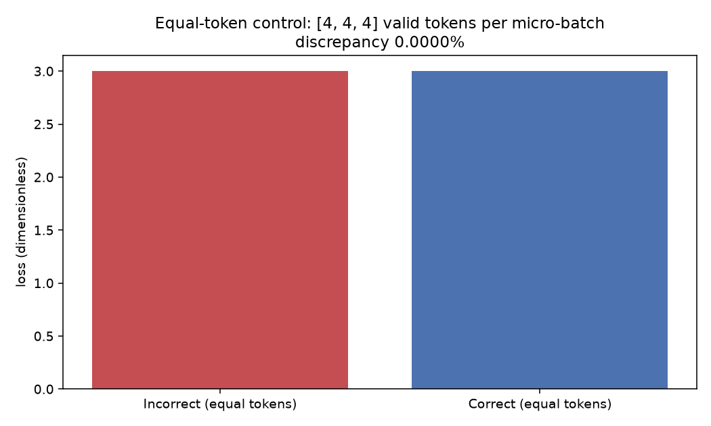
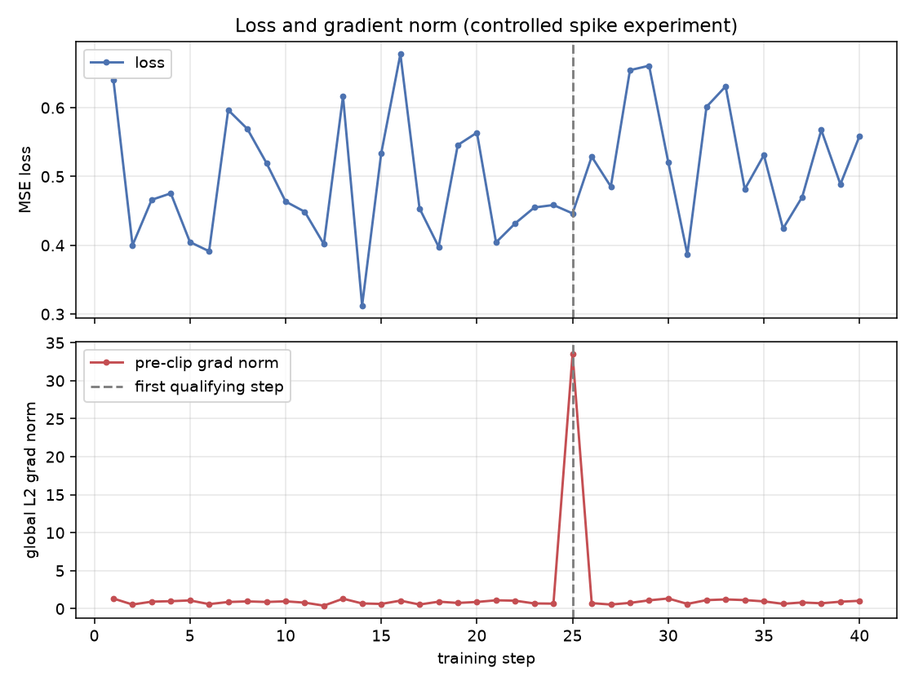
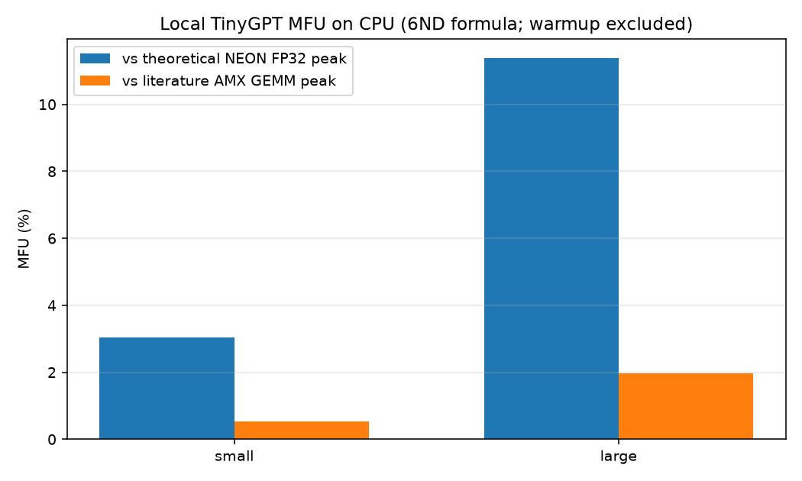

# ERA V5 Session 10 — The Training Loop

**Run:** `outputs/runs/20261025T151820Z`  
**Truth log (printed by the loop):** `outputs/logs/training_truth.txt`  
**Host:** Apple M2, 8 GB unified memory, macOS 15.1.1, arm64  
**Software:** Python 3.11.8, PyTorch 2.14.1, NumPy 2.4.6, Matplotlib 3.11.2  
**Device used:** CPU (`configs/default.yaml`). CUDA unavailable. MPS is visible to this PyTorch build and was **not** used for the measured training/MFU numbers.  
**Seed:** 42  

Commands:

```bash
python -m pytest -q
python -m experiments.run_all --overwrite
```

pytest (this process): **69 passed, 0 failed, 0 skipped, 0 errors** in 1.011 s (`outputs/metrics/pytest.xml`). In a sandboxed process without MPS, the single `@pytest.mark.gpu` test is skipped instead of failing.

---

## 1. Executive summary

A minimal but real training loop was implemented, instrumented, tested, and run end-to-end on CPU. All six mandatory experiments produced measured artifacts.

1. One TinyGPT training step dumped every relevant tensor with an axis-by-axis explanation (`B` batch, `T` sequence, `C` feature, `V` vocabulary, `H` heads).
2. For `L = (w2·w1·x − 20)²` the chain-rule gradient `∂L/∂w1 = 64` matches PyTorch autograd to 0 absolute error in float64. A central finite difference at `ε = 10⁻⁶` has relative error `1.26 × 10⁻¹⁰`. Nudging `fc1.weight[0,0]` in a real TinyMLP loop agrees with `backward()` to relative error `1.55 × 10⁻⁸`.
3. Three micro-batches with 4, 4, and 2 valid tokens and means 2, 2, and 5 give a token-weighted loss of **2.6** and a mean-of-means of **3.0** (relative discrepancy **15.3846%**). Both numbers were produced by actual `backward()` on a scalar parameter. Plotted as curves, the two reductions coincide until the short batch arrives, then the gap is a trajectory, not a single bar. An equal-token control makes the discrepancy **0**.
4. A controlled gradient spike at step 25 raised the pre-clip global norm from 0.665 to **33.50** while the loss stayed at **0.446**. The loss moved on step 26 to **0.529**. In this run the gradient norm changed first. That ordering is a property of this injection, not a universal law.
5. The assignment’s 9 B / 12 k tok/s illustration reproduces **648 TFLOP/s** and **8.19% MFU** against the stated 7,912 TFLOP/s peak (the brief’s “≈ 8.2%”). Local TinyGPT on this CPU measured **31.5 k** and **118.3 k** tok/s for two batch/seq configs, i.e. **3.03%** and **11.39%** of a documented NEON FP32 peak. CUDA MFU is **not reported**; it was not measured.
6. Decimal 0.1 encodes as FP32 `0x3dcccccd`, BF16 `0x3dcd`, OCP FP8 E4M3FN `0x1d`, each cross-checked against `struct` / NumPy / `torch.bfloat16` / `torch.float8_e4m3fn`. Recommended training precision **for this environment** is **FP32**.

---

## 2. Requirements and acceptance matrix

| ID | Requirement | Implementation | Tests | Experiment | Artifacts | Report | Result |
|---|---|---|---|---|---|---|---|
| R1 | Print every tensor shape in a complete step and explain every dimension | `src/training_loop.py`, `src/models.py`, `src/instrumentation.py` | `tests/test_shapes.py` | `run_shape_experiment` | `outputs/logs/training_step_shapes.txt`, `outputs/metrics/shapes.json` | §4 | **PASS** |
| R2 | Verify one gradient analytically, with autograd, and with finite differences | `src/gradient_verification.py` | `tests/test_gradients.py` | `run_gradient_experiment` | `outputs/metrics/gradient_verification.json`, `outputs/figures/finite_difference_error.png` | §5 | **PASS** |
| R3 | Demonstrate the averaging-averages accumulation bug; plot incorrect vs correct | `src/accumulation_experiment.py` | `tests/test_accumulation.py` | `run_accumulation` | `outputs/metrics/accumulation.json`, `outputs/figures/accumulation_*.png` | §6 | **PASS** |
| R4 | Log grad norms every step; identify a case where the norm changes before the loss | `src/gradient_monitor.py` | `tests/test_monitoring.py` | `run_monitoring` | `outputs/logs/grad_norm_steps.csv`, `outputs/figures/loss_and_grad_norm.png` | §7 | **PASS** |
| R5 | Independent MFU, assumptions, hardware, gap to 40% | `src/mfu.py` | `tests/test_mfu.py` | `run_mfu` | `outputs/metrics/mfu.json`, `outputs/figures/mfu_configs.png` | §8 | **PASS** (CPU). **BLOCKED** (CUDA MFU: no CUDA; not invented) |
| R6 | Bit representation of 0.1 in FP32, BF16, FP8 E4M3; justify training precision | `src/precision.py` | `tests/test_precision.py` | `run_precision` | `outputs/logs/precision_0p1.txt`, `outputs/metrics/precision.json` | §9–10 | **PASS** |

Machine-readable map: `configs/traceability.yaml`.

---

## 3. Architecture and implementation

Two models share one training step:

- `TinyMLP` — regression, used to overfit a tiny dataset and to host the grad-norm spike.
- `TinyGPT` — 2-layer causal transformer (`vocab=64`, `n_embd=32`, `n_head=4`, `block_size=32`, **30,336** trainable parameters), used for shape tracing and MFU token accounting.

The conventional step is:

```
logits = model(inputs)
loss = loss_fn(logits, targets)
optimizer.zero_grad(set_to_none=True)
loss.backward()
grad_norm = calculate_grad_norm(model.parameters())
optimizer.step()
```

Clearing gradients *before* `backward` is the correct conventional loop. A second path, used only in the accumulation experiment, leaves `.grad` in place across micro-batches and steps the optimiser once.

PyTorch adds into `p.grad` when it already exists. That is why accumulation works, and why forgetting `zero_grad` in an ordinary loop silently rescales the update. On this machine two identical minibatches without a clear produced **exactly 2×** the gradient (`mean_ratio = 2.0`, `allclose_double = true`).

Safety checks refuse NaN/Inf loss and grads, non-scalar loss, dtype/shape mismatches, missing trainable grads, non-finite parameters after a step, checkpoint architecture mismatch, unsupported devices/precisions, and MFU unit mistakes. They never rewrite an invalid measurement into a plausible one.

---

## 4. Tensor shapes and their meaning

One TinyGPT step, `batch=2`, `seq=8`, `d_model=32`, `n_head=4`, `vocab=64`. Measured loss **4.319** (untrained CE is near `log 64 ≈ 4.159`), global grad norm **1.636**, elapsed **0.053 s**.

| Tensor | Shape | Axes | Meaning |
|---|---|---|---|
| `input_ids` | (2, 8) | batch × sequence | Token ids |
| `tok_emb` | (2, 8, 32) | batch × sequence × feature | Embedding lookup |
| `pos_emb` | (8, 32) | sequence × feature | Absolute positions, broadcast over batch |
| `layer*.attn.q/k/v` | (2, 4, 8, 8) | batch × head × sequence × head_dim | `head_dim = 32/4 = 8` |
| `layer*.attn.scores` | (2, 4, 8, 8) | batch × head × sequence × sequence | Causal attention weights |
| `layer*.mlp.hidden` | (2, 8, 128) | batch × sequence × 4×feature | FFN width |
| `logits` | (2, 8, 64) | batch × sequence × vocabulary | Unnormalised class scores |
| `targets` | (2, 8) | batch × sequence | Class indices, integer dtype |
| `loss` | () | scalar | Mean CE; 0-d tensor, not `(1,)` |
| `grad.*` | same as parameter | parameter axes | `∂L/∂p` |
| Adam `exp_avg`, `exp_avg_sq` | same as parameter | parameter axes | First-step optimiser state |

Full dump: `outputs/logs/training_step_shapes.txt`.

Overfit evidence (TinyMLP, 8 samples, 400 SGD steps, 321 parameters): initial MSE **0.585**, final **7.99×10⁻¹⁵**, residual on the same points **6.22×10⁻¹⁵**, threshold `10⁻⁴`. A decreasing loss was not accepted as sufficient; the residual on the training points had to fall below the threshold.



---

## 5. Manual, autograd, and finite-difference gradient verification

Graph (all values float64):

```
x = 2,  w1 = 3,  w2 = 4,  target = 20
h = w1 · x = 6
y = w2 · h = 24
L = (y − target)² = 16
```

Chain rule:

```
∂L/∂y  = 2(y − 20) = 8
∂L/∂w2 = (∂L/∂y) · h  = 48
∂L/∂h  = (∂L/∂y) · w2 = 32
∂L/∂w1 = (∂L/∂h) · x  = 64
```

| Source | `∂L/∂w1` | `∂L/∂w2` | `L` |
|---|---:|---:|---:|
| Analytical | 64 | 48 | 16 |
| Autograd | 64 | 48 | 16 |
| Absolute error | 0 | 0 | 0 |

Central difference `(L(w1+ε) − L(w1−ε)) / (2ε)`, float64:

| ε | numerical `∂L/∂w1` | relative error |
|---:|---:|---:|
| 1e-2 | 63.999999999998636 | 2.13×10⁻¹⁴ |
| 1e-4 | 64.00000000013506 | 2.11×10⁻¹² |
| **1e-6** (pass ε) | **64.00000000805761** | **1.26×10⁻¹⁰** |
| 1e-8 | 63.99999961104186 | 6.08×10⁻⁹ |
| 1e-10 | 64.00000529538374 | 8.27×10⁻⁸ |
| 1e-12 | 64.00568963726982 | 8.89×10⁻⁵ |

Pass criterion: analytical vs autograd absolute error `≤ 10⁻¹²`; finite-difference relative error at `ε = 10⁻⁶` `≤ 10⁻⁶`. **Both passed.**

On a real TinyMLP training step, `fc1.weight[0, 0]` was nudged by `ε = 10⁻⁴` in float64. Autograd reported `-0.0055320109`; `(L₊ − L₋)/(2ε)` reported `-0.0055320109`; relative error `1.55×10⁻⁸`. They agree to several decimals. If they had not, the graph or the loss would have been the thing to inspect — not the loss curve.

**Truncation vs cancellation.** In general a central difference has `O(ε²)` truncation and roughly `O(ε_machine/ε)` cancellation. This assignment loss is `L(w1) = (8 w1 − 20)²`, a quadratic, so the `O(ε²)` term is *identically zero*. That is why `ε = 10⁻²` is the most accurate row here. Cancellation still appears: at `ε = 10⁻¹²` the relative error has grown by six orders of magnitude. float64 (`ε_machine ≈ 2×10⁻¹⁶`) is what keeps `ε = 10⁻⁶` comfortable.

An auxiliary cubic `L = w³` (not the assignment graph) makes truncation visible: at `ε = 10⁻²` the error matches `ε²` to several digits (observed `9.99999995×10⁻⁵` vs `10⁻⁴`); at `ε = 10⁻¹²` cancellation dominates (`|ĝ − 27| = 0.0024`).





---

## 6. Incorrect versus correct gradient accumulation

Specified micro-batches: 4 tokens @ mean 2.0, 4 @ 2.0, 2 @ 5.0.

```
correct   = (4·2 + 4·2 + 2·5) / 10 = 2.6
incorrect = (2 + 2 + 5) / 3         = 3.0
|3.0 − 2.6| / 2.6                   = 15.3846%
```

These are not just arithmetic checks. `ScalarTokenModel` has one parameter `θ`; per-token loss is `θ · c_i`. At `θ = 1` the constructed coefficients realise the specified means. Method A calls `backward(mb_mean / n_mb)` on each micro-batch. Method B calls `backward(sum_valid / N_total)` on each micro-batch and steps only afterwards. Padding tokens have coefficient 999 and mask 0; including them would move the loss to 168.67, which is how the pad-exclusion test fails loudly.

| Method | Loss | `∂L/∂θ` |
|---|---:|---:|
| Incorrect (mean of means) | 3.0 | 3.0 |
| Correct (token-weighted) | 2.6 | 2.6 |
| Concatenated valid tokens (reference) | 2.6 | 2.6 |

Method B matches the concatenated-token mean, which is the intended global objective.

**Equal-token control.** Three micro-batches of 4 valid tokens with the same means 2, 2, 5: both reductions give 3.0, discrepancy **0**. Averaging averages equals averaging tokens if and only if every micro-batch contributes the same number of valid tokens (or the means happen to be equal). Otherwise the short batch is over-weighted.











---

## 7. Gradient-norm and loss experiment

Global norm:

```
global_norm = sqrt(Σ_parameters Σ_elements grad²)
```

Implemented with `torch.linalg.vector_norm` on the concatenated float32 views. Missing grads: `skip`/`zero` contribute nothing; `error` raises. Zero norms are not inverted: clip scale is 1.0.

Clip: `scale = min(1, C / global_norm)` for `global_norm > 0`. Each row logs step, loss, pre-clip norm, threshold, scale, post-clip norm.

**This run.** Spike injected at step 25 (`×50` on every grad after `backward`, before clip/step). Clip threshold `C = 5`. Detection rule: first step whose pre-clip norm is `≥ 5×` the median pre-spike norm, while the loss is still within 25% of the previous step; then compare the loss move on the next step.

From `outputs/logs/grad_norm_steps.csv`:

| Step | Loss | Pre-clip norm | Scale | Post-clip | Spike? |
|---:|---:|---:|---:|---:|---|
| 24 | 0.4585 | 0.6654 | 1.0 | 0.6654 | no |
| **25** | **0.4463** | **33.50** | **0.149** | **5.0** | **yes** |
| 26 | 0.5289 | 0.7329 | 1.0 | 0.7329 | no |

First qualifying step from the logs: **25**. Loss delta at 25 vs step 24: **0.012**. Loss delta 25→26: **0.083**. The norm moved at 25; the loss moved at 26.

This demonstrates a leading indicator **in this controlled run**. It is not claimed for SGD in general. Clipping, Adam, and data noise can hide or reverse it.



---

## 8. MFU formula, methodology, results, limitations

### Formula

```
estimated_training_flops_per_second = 6 · N · tokens_per_second
MFU = estimated_training_flops_per_second / available_hardware_flops_per_second
```

`6N` is the transformer-training rule of thumb (about 2N forward + 4N backward on the dominant matmuls). It is an estimate, not a profiler count. All arithmetic is in **FLOP/s** and **seconds**. `tflops_to_flops` multiplies by `10¹²`; treating 648 TFLOP/s as 648 FLOP/s would inflate MFU by `10¹²` and is rejected by tests. Treating milliseconds as seconds would deflate tokens/s by 1000 and is likewise tested.

### Assignment-provided illustration (not a local measurement)

| Quantity | Stated | Computed here |
|---|---:|---:|
| Parameters | 9×10⁹ | — |
| Throughput | 12,000 tok/s | — |
| Achieved | 648 TFLOP/s | `6 · 9e9 · 12000 = 6.48×10¹⁴` FLOP/s = **648 TFLOP/s** |
| Peak | 7,912 TFLOP/s | — |
| MFU | ≈ 8.2% | **8.190%** |

These figures are labelled `assignment-provided illustrative figures, not a local benchmark` in `outputs/metrics/mfu.json`.

### Local measurement

- Model: TinyGPT, **N = 30,336** trainable parameters (equal to total; nothing frozen).
- Precision: FP32. Device: CPU. Warm-up: 5 steps, excluded. Timed: 20 steps, `time.perf_counter`.
- Tokens/step = `batch_size × seq_len`.

**Peak used as primary denominator:** theoretical NEON FP32 FMA peak for this chip.

```
4 P-cores × 3.49 GHz × 4 FP32 lanes × 2 FMA FLOPs = 111.68 GFLOP/s
4 E-cores × 2.42 GHz × 4 FP32 lanes × 2 FMA FLOPs =  77.44 GFLOP/s
Total = 189.12 GFLOP/s = 0.18912 TFLOP/s
```

This is a **theoretical vector peak**, not a measured GEMM number. A published M2 CPU SGEMM peak of **1.09 TFLOP/s** (Banchelli et al., arXiv:2502.05317, Accelerate/AMX) is reported as a secondary *literature* effective peak and was **not** reproduced in this repo.

| Config | B | T | Elapsed (s) | tok/s | 6N tok/s (TFLOP/s) | MFU vs NEON | MFU vs literature AMX |
|---|---:|---:|---:|---:|---:|---:|---:|
| small | 4 | 16 | 0.0406 | 31,513 | 0.00574 | **3.03%** | 0.53% |
| large | 16 | 32 | 0.0865 | 118,323 | 0.0215 | **11.39%** | 1.98% |



### Gap to 40%

The large config is **28.6 percentage points** below 40% against the NEON peak, and **38.0 points** below against the AMX literature peak. Throughput here is a timed interval, so it moves a little from run to run; the conclusion does not. Likely causes, in this run, with no claim that one of them is the whole gap:

- The workload is tiny; Python, autograd, and kernel launch dominate.
- Eager PyTorch on CPU has no fused transformer kernel.
- `6N` itself over/under-counts a 32-wide TinyGPT (embeddings, softmax, LayerNorm are not 6N).
- Small GEMMs are launch-bound even when cache-resident.
- No tensor cores are involved. The “around 40%” regime is large-batch training on large accelerators; it is not a universal threshold.

CUDA MFU is **BLOCKED**: `torch.cuda.is_available() is False`. MPS is visible in this build and was not used (`device: cpu`). No GPU MFU number is reported.

---

## 9. FP32, BF16, and FP8 E4M3 bit-level analysis of 0.1

Fields:

| Format | Sign | Exponent | Fraction | Bias | Specials |
|---|---:|---:|---:|---:|---|
| IEEE FP32 | 1 | 8 | 23 | 127 | Inf/NaN when exp = 255 |
| BF16 | 1 | 8 | 7 | 127 | Same range as FP32, Inf/NaN when exp = 255 |
| **OCP FP8 E4M3FN** (this report) | 1 | 4 | 3 | 7 | **No Inf.** NaN only `S.1111.111`. Max finite ±448. Other `exp=1111` patterns are ordinary normals. |

This E4M3 convention is OCP OFP8 / PyTorch `torch.float8_e4m3fn`. It is not E5M2, not IEEE-with-infinities E4M3, and not FN-UZ.

Exact value: `1/10`. Binary long division (independent of IEEE libraries):

```
0.1₁₀ = 0.0001100110011…₂  (0011 repeating after three leading zeros)
      = 1.1001100110011…₂ × 2⁻⁴
```

Unbiased exponent before rounding: **−4**.

Round-to-nearest-even on the stored fraction:

| Format | Encoded exp | Fraction | Grouped bits | Hex | Represented value | Abs error vs 1/10 |
|---|---:|---|---|---|---:|---:|
| FP32 | 123 = `01111011` | `10011001100110011001101` | `0 01111011 10011001100110011001101` | `0x3dcccccd` | 0.10000000149011612 | 1.490×10⁻⁹ |
| BF16 | 123 | `1001101` | `0 01111011 1001101` | `0x3dcd` | 0.10009765625 | 9.766×10⁻⁵ |
| E4M3FN | 3 = `0011` | `101` | `0 0011 101` | `0x1d` | 0.1015625 | 1.5625×10⁻³ |

Discarded bits of the repeating tail start `11001100…`. FP32 rounds that tail up (the 24th bit is 1 with sticky), BF16 rounds the 8th fraction bit up, FP8 rounds the 4th fraction bit up (`100` → `101`), which is `1.101₂ × 2⁻⁴ = 1.625/16 = 0.1015625`.

**Independent checks (not the same derivation reused as its test):**

- FP32 bits = `struct.pack('>f', 0.1)` = `numpy.float32(0.1).view(uint32)` = `0x3dcccccd`
- BF16 bits = `torch.tensor(0.1).to(bfloat16).view(int16)` = `0x3dcd`
- FP8 bits = `torch.tensor(0.1).to(float8_e4m3fn).view(uint8)` = `0x1d`
- OCP decoder vectors: `0x38 → 1.0`, `0x7E → 448`, `0x78 → 256` (finite!), `0x7F` is NaN, min normal `2⁻⁶`

All matches in `outputs/metrics/precision.json` are true.

---

## 10. Precision recommendation and rationale

Representation error on the single constant 0.1 ranks the formats by significand width (FP32 ≪ BF16 ≪ E4M3). That ranking is true and insufficient.

| Concern | FP32 | BF16 | FP8 E4M3FN | Block-scaled FP4 |
|---|---|---|---|---|
| Exponent range | Wide | Same as FP32 | Tiny (`emax=8`, max 448) | Element type plus a shared scale |
| Under/overflow | Rare at this size | Rare | Common without scaling | Depends on block scale |
| Accumulators | Native | Usually FP32 master | Must keep FP32 master + scale | Scale-aware stack required |
| Hardware here | Native CPU | Dtype exists; no tensor-core win | Analysis only on this CPU | Not present |
| Throughput | Baseline | Win on Ampere+/TPU | Win on Hopper/Blackwell with scaling | MX hardware |

**Recommendation for the measured environment: FP32.**

CUDA is absent. The suite is pinned to CPU. BF16 mixed precision with FP32 master weights is the usual large-model default *on CUDA tensor cores*, which we do not have. FP8 E4M3FN is a distinct, scaled format, not a drop-in dtype. Block-scaled FP4 (MXFP4 and relatives) is a third stack. None of those three should be chosen because 0.1 happens to round more or less badly.

---

## 11. Test plan and actual test results

69 tests in `tests/`, collected and executed in this process:

```
69 passed, 0 failed, 0 skipped, 0 errors   in 1.011s
```

JUnit: `outputs/metrics/pytest.xml`. Coverage of Phase 9 failure modes:

| Condition | Test | Behaviour |
|---|---|---|
| NaN / Inf loss | `test_nan_loss_is_rejected`, `test_inf_loss_is_rejected` | `TrainingSafetyError` |
| NaN / Inf grads | `test_nan_gradients_raise`, `test_inf_gradients_raise` | `TrainingSafetyError` |
| Zero grad norm | `test_zero_norm_clip_scale_is_one` | scale = 1; not inverted |
| Extremely large grads | `test_extremely_large_gradients_are_clipped_not_hidden` | pre-clip logged; clipped to C |
| Missing grads | `test_missing_gradients_on_trainable_params`, `test_missing_grad_skip_vs_error` | error or skip, never invented |
| Non-finite parameters | `test_non_finite_parameters_after_update` | `TrainingSafetyError` |
| Wrong shapes / dtypes | `test_incorrect_shapes`, `test_incorrect_target_dtype` | `TrainingSafetyError` |
| Wrong reduction | `test_incorrect_loss_reduction` | rejects `"average"` |
| Forgotten zero_grad | `test_forgotten_zero_grad_approximately_doubles` | 2× gradient |
| Wrong accumulation scaling | `test_incorrect_scaling_is_not_the_token_mean` | disagrees with method B |
| Pad tokens in the loss | `test_padding_tokens_are_excluded` | pad-included loss ≫ 2.6 |
| Wrong N in MFU | `test_incorrect_parameter_count_changes_mfu` | 6 B vs 9 B moves MFU by > 1 point |
| Seconds vs milliseconds | `test_seconds_vs_milliseconds` | 12,000 vs 12 tok/s |
| TFLOP/s vs FLOP/s | `test_tflop_vs_flop_conversion` | `10¹²` mistake is obvious |
| Unsupported precision/device | `test_unsupported_precision_on_cpu`, `test_unsupported_device` | `PrecisionError` / `RuntimeError` |
| Checkpoint mismatch | `test_checkpoint_shape_mismatch` | `TrainingSafetyError` |
| Missing seed | `test_non_reproducible_config_rejected` | `ValueError` |

GPU-marked test: passed here because MPS is visible; skipped in CPU-only sandboxes.

---

## 12. Failure modes and debugging findings

- **Quadratic finite differences have no truncation.** The first version of `test_epsilon_tradeoff_visible` assumed `ε=10⁻²` would be worse than `ε=10⁻⁶`. It was *better*, because `L(w1)` is quadratic. The test and the report were changed to state that, and a cubic auxiliary was added so the textbook trade-off is still visible.
- **Shape records are dataclasses.** Tests that treated them as dicts failed until they used `tracer.as_dicts()`.
- **Mean-of-means is not a token mean.** The pad-included loss (168.67 vs 2.6) is the loud failure if the mask is dropped; a 15% discrepancy is easy to miss in a noisy LM loss.
- **Unit mistakes dwarf modelling mistakes.** Calling 648 TFLOP/s “648 FLOP/s” or timing in milliseconds without converting dominates any 6N modelling error.
- **A falling loss is cheap.** Overfit is accepted only when residual MSE on the same 8 points is below `10⁻⁴`. Forgotten `zero_grad` still produces a falling loss and is still wrong.

---

## 13. Reproduction instructions

From a clean tree:

```bash
cd Assignment10
python3 -m venv .venv
source .venv/bin/activate          # Windows: .venv\Scripts\activate
pip install -r requirements.txt
python -m pytest -q
python -m experiments.run_all --overwrite
```

Expected: pytest 69 passed on a machine with MPS visible (68 passed + 1 skipped without GPU/MPS); `run_all` prints PASS for shapes, gradients, accumulation, monitoring, mfu, precision, overfit, and writes `outputs/logs/training_truth.txt`.

Artifacts land in `outputs/runs/<UTC>/` and are mirrored to `outputs/{figures,logs,metrics}/`. A previous timestamped run is never deleted. `--overwrite` only replaces the stable copies.

Config and seed: `configs/default.yaml`, `seed: 42`. Environment snapshot: `outputs/metrics/environment.json`.

---

## 14. Limitations and next steps

- MFU uses the 6N approximation on a 32-wide toy transformer; a real FLOP counter (e.g. profiler / Nsight) was not used.
- The NEON peak is calculated from documented clocks, not measured with a local SGEMM. The 1.09 TFLOP/s AMX figure is literature, not this repo.
- CUDA training and CUDA MFU are absent. MPS was visible and unused; an MPS MFU would be a next measurement, not a number to invent.
- The grad-norm leading indicator is injected. A hunt through an uncontrolled SGD trajectory was not the acceptance path.
- FP8 is encoded/decoded; it is not a training dtype on this CPU.
- Deterministic algorithms are requested with `warn_only=True`; some ops may still be non-deterministic on other backends.

Next steps worth doing, in order: measure a local SGEMM peak; optionally time TinyGPT on MPS; replace 6N with a counted FLOP model of TinyGPT; try the accumulation bug on a padded LM batch with real CE.

---

## Acceptance report

| Deliverable | Status | Evidence |
|---|---|---|
| R1 Tensor shapes + explanations | **PASS** | `outputs/logs/training_step_shapes.txt`; 6 shape tests |
| R2 Analytical / autograd / finite difference | **PASS** | autograd error 0; FD rel. error at 1e-6 = 1.26×10⁻¹⁰; TinyMLP nudge rel. error 1.55×10⁻⁸ |
| R3 Accumulation bug + plots + equal-token control | **PASS** | 2.6 vs 3.0, 15.3846%; curves in `accumulation_curves.png`; equal-token discrepancy 0 |
| R4 Grad-norm log + leading-indicator step from data | **PASS** | step 25 in `grad_norm_steps.csv` (norm 33.50, loss 0.446); loss jump at 26 |
| R5 MFU formula + local CPU measurement + gap analysis | **PASS** | assignment 8.19%; local 3.03% / 11.39% vs NEON |
| R5 CUDA/GPU MFU | **BLOCKED** | CUDA unavailable; GPU numbers not invented |
| R6 FP32 / BF16 / E4M3FN bits of 0.1 + recommendation | **PASS** | `0x3dcccccd` / `0x3dcd` / `0x1d`; recommend FP32 here |
| Overfit + forgotten `zero_grad` | **PASS** | residual 6.22×10⁻¹⁵; ratio exactly 2 |
| Phase 9 failure tests | **PASS** | 69/69 pytest in this process |
| CPU tests without GPU dependency | **PASS** | default device cpu; gpu tests marked skippable |
| Reproducible suite, non-zero on failure, no silent overwrite of run history | **PASS** | timestamped `outputs/runs/`; pytest + `run_all` exit codes |
| Report uses measured numbers, not fabrications | **PASS** | all figures cited from JSON/CSV written by the suite |
