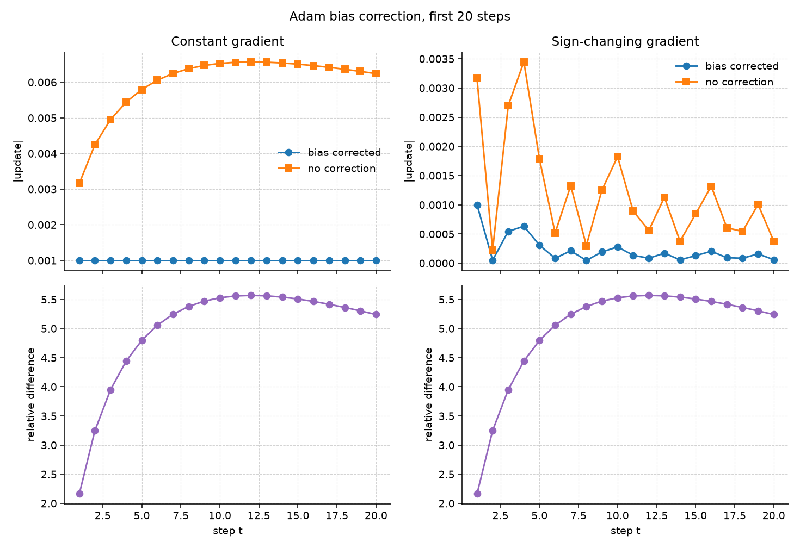
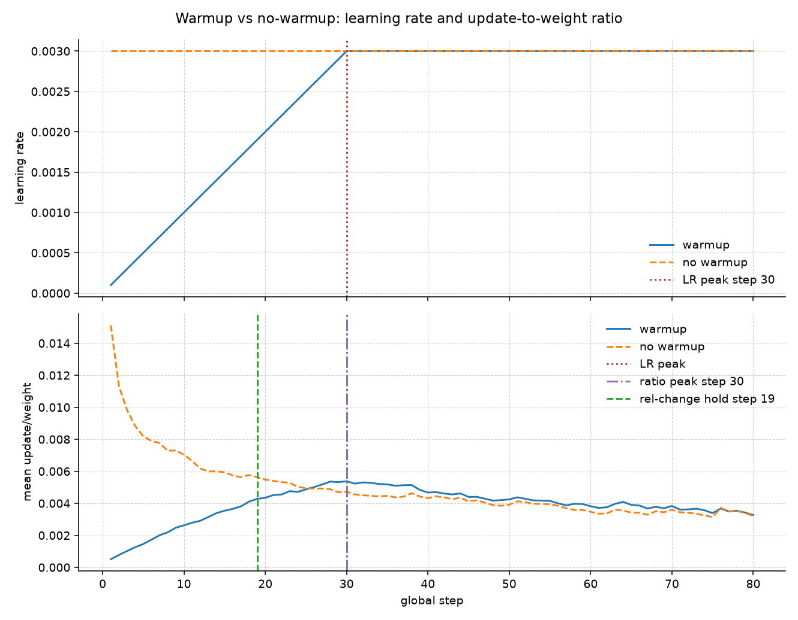
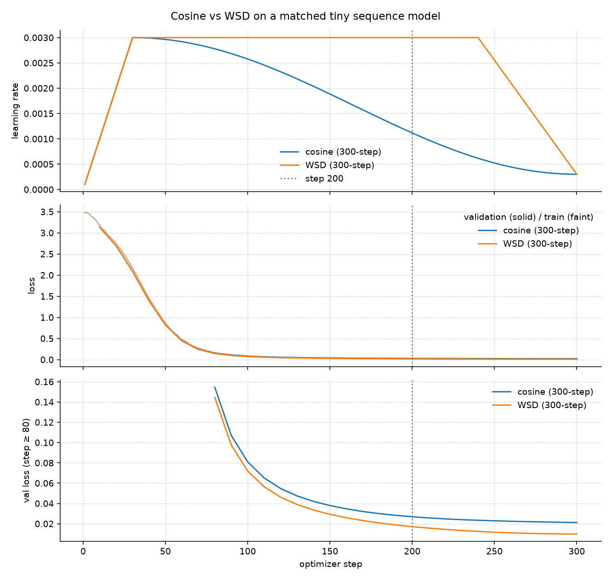
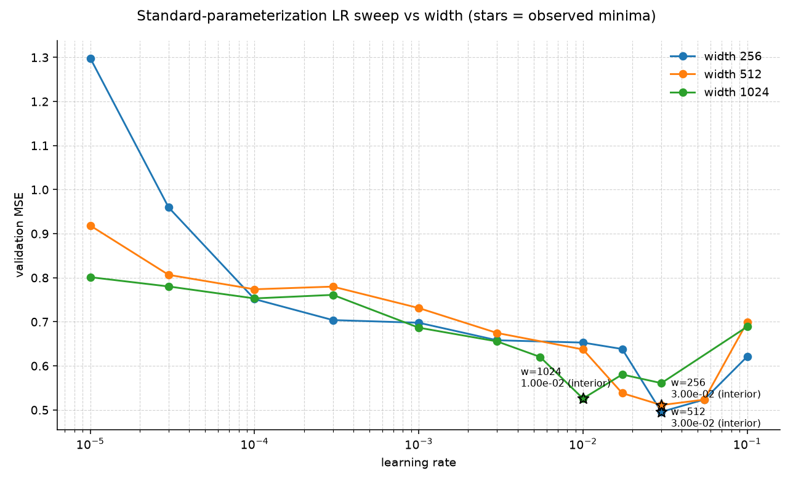

# ERA V5 Session 11 — Optimizers and Learning-Rate Schedules

This report is generated from `artifacts/results.json`. Every numeric claim below was measured by the code in `src/`.

## 1. Setup

- Python: `3.11.8 (main, May  2 2025, 02:17:14) [Clang 16.0.0 (clang-1600.0.26.4)]`
- PyTorch: `2.14.1`
- Device: `cpu`
- Seed: `42`
- CUDA available: `False`  MPS available: `True`

The implementation is original. A public reference repository was used only to confirm the assignment's scope. Its source, plots, and numbers were not copied.

## 2. Task A — Manual Adam vs `torch.optim.Adam`

t starts at 1 for the first gradient. Moments are initialized to 0. The parameter update is w_t = w_{t-1} + delta_w_t with delta_w_t = -lr * m_hat / (sqrt(v_hat) + eps) when bias correction is on.

Default matches PyTorch: epsilon is added after the bias-corrected second-moment square root, not inside it.

Defaults: `w0=1.0`, `lr=0.001`, `beta1=0.9`, `beta2=0.999`, `eps=1e-08`, gradients `[0.5, 0.4, 0.6, 0.45, 0.55]`.

Manual Adam is implemented in IEEE-754 float64 (Python `float`) without calling `torch.optim.Adam` for the update. The no-bias-correction class never writes `m_hat` / `v_hat`.

| t | g | m | v | m_hat | v_hat | delta_w | w |
| --- | --- | --- | --- | --- | --- | --- | --- |
| 1 | 0.5000 | 0.05 | 0.00025 | 0.5 | 0.25 | -0.00099999998 | 0.99900000002 |
| 2 | 0.4000 | 0.085 | 0.00040975 | 0.44736842 | 0.20497749 | -0.00098812578 | 0.998011874238 |
| 3 | 0.6000 | 0.1365 | 0.00076934025 | 0.50369004 | 0.25670337 | -0.00099414005 | 0.997017734191 |
| 4 | 0.4500 | 0.16785 | 0.00097107091 | 0.48807793 | 0.24313218 | -0.00098984669 | 0.996027887498 |
| 5 | 0.5500 | 0.206065 | 0.0012725998 | 0.50319895 | 0.25502952 | -0.00099642471 | 0.995031462787 |

- Worst absolute disagreement vs float64 `torch.optim.Adam` across listed intermediates: **1.110e-16**
- Documented tolerance: `1e-12`
- Agrees under that tolerance: **True**
- Textbook form vs PyTorch form (epsilon after the scaled second moment): worst error `4.337e-19`
- Moving epsilon inside the `v` bias correction differs: `True` (worst error `1.975e-09`)

Any residual gap, if present, is from floating-point evaluation order, not from a different algorithm. Weight decay is zero so this is Adam, not AdamW.

## 3. Task B — Bias correction over 20 steps

rel_diff(t) = |delta_uncorrected(t) - delta_corrected(t)| / max(|delta_corrected(t)|, eps_rel). If the corrected update is smaller than eps_rel the denominator is clamped and the row is flagged.

### Scenario: constant

- First-step relative difference: **2.16228**
- Maximum over the first 20 steps: **5.56852** at step `12`
- Relative difference at step 20: **5.24093**
- Trend in the 20-step window: **rises_then_falls**
- Do the two methods agree by step 20 at tolerance `0.01`? **False**
- Persistent crossing inside the 20-step plot: `False`
- Persistent crossing in the extended search (limit `20000`): `True` at step **3925**, holding for 5 steps

### Scenario: varying

- First-step relative difference: **2.16227**
- Maximum over the first 20 steps: **5.56852** at step `12`
- Relative difference at step 20: **5.24093**
- Trend in the 20-step window: **rises_then_falls**
- Do the two methods agree by step 20 at tolerance `0.01`? **False**
- Persistent crossing inside the 20-step plot: `False`
- Persistent crossing in the extended search (limit `20000`): `True` at step **3925**, holding for 5 steps



When epsilon is negligible compared with `sqrt(v)`, the relative difference reduces to `| (1-β1^t)/√(1-β2^t) - 1 |`, which depends on `t` and the betas, not on the gradient sequence. That is why the two relative-difference panels look almost the same while the raw update magnitudes do not.

The 20-step figure is the required window. The persistent-tolerance step is labelled separately and is not inferred from that figure.

## 4. Task C — Update-to-weight ratios and warmup

||parameter_after - parameter_before||, not the gradient norm.

ratio = ||delta|| / max(||w_before||, ratio_eps). Tensors whose *initial* ||w|| is below near_zero_weight_eps (zero-init biases) stay flagged for the whole run and are excluded from the headline mean; otherwise a tiny bias that moved on step 1 would dominate later ratios. Missing gradients are excluded. Non-finite values raise.

The schedule reaches its peak at warmup_steps by construction. The observed update-to-weight ratio can level off earlier or later because Adam's effective step size also depends on the moment estimates and the shrinking residual, not only on the nominal LR.

- Learning-rate ramp reaches its peak at step **30**.
- Mean update-to-weight ratio (warmup arm) is largest at step **30**.
- Relative-change of that ratio first holds within tolerance at step **19** (this can fire during a slow climb; it is not the same event as the LR peak).
- LR-peak step equals relative-change hold step: **False**.
- Zero-init tensors excluded from the headline mean: `['head.bias', 'hidden.bias', 'norm1.bias', 'norm2.bias', 'stem.bias']`
- Final training loss with warmup: `0.239339`
- Final training loss without warmup: `0.164837`



Zero-initialized biases are present in the instrumented MLP. Their ratios are computed with a clamped denominator and excluded from the headline mean.

## 5. Task D — Cosine decay vs WSD

Step 200 is an early-stop snapshot on a 300-step schedule, not a finished cosine run. Cosine has already started decaying; WSD is still at the peak. A 200-step-designed pair is reported separately because the ranking can change with the planned horizon.

Single seed, synthetic modular-increment sequences, tiny Transformer. Results are not a universal ranking of cosine vs WSD.

| schedule | LR @200 | train @200 | val @200 | train @300 | val @300 | mean LR @200 | mean LR @300 |
| --- | --- | --- | --- | --- | --- | --- | --- |
| cosine | 1.1153e-03 | 0.027176 | 0.026828 | 0.0208732 | 0.0211267 | 2.1630e-03 | 1.6355e-03 |
| WSD | 3.0000e-03 | 0.0171821 | 0.0170732 | 0.0095851 | 0.00981776 | 2.7825e-03 | 2.5805e-03 |

- Lower validation loss at step 200 (300-step schedules): **wsd**
- Lower validation loss at step 300: **wsd**
- Lower validation loss when both schedules are designed for a 200-step budget: **wsd**

The comparison depends on the planned horizon and on the average learning rate spent, not only on the shape name. WSD is not claimed to be universally better. On this synthetic next-token walk the model is still improving at step 200, so the arm that spent more average LR (WSD, still at the peak) wins both at the early-stop checkpoint and at step 300. Redesigning both schedules for a 200-step budget did not reverse that ranking here, because the cosine-200 run has already annealed while the task still benefits from a larger step size.

When both schedules are built for 200 steps, cosine finishes its decay at the evaluation point while WSD spends a short terminal decay. That is a different experiment from reading the step-200 checkpoint of a 300-step run.

- Cosine-200 final val: `0.0471283`
- WSD-200 final val: `0.0192366`



## 6. Task E — Learning-rate sweep across widths

standard (Kaiming hidden, 1/sqrt(fan_in) head, zero biases). Not μP.

- Optimizer: `Adam`, weight decay `0.0`, budget `60` steps.
- Metric: validation MSE against a frozen width-64 teacher.
- Seed: `42`.

| width | best LR | val MSE | train loss | on grid boundary | grid expanded |
| --- | --- | --- | --- | --- | --- |
| 256 | 3.0000e-02 | 0.495657 | 0.210646 | False | False |
| 512 | 3.0000e-02 | 0.511019 | 0.266144 | False | False |
| 1024 | 1.0000e-02 | 0.525859 | 0.212671 | False | False |

Log-log fit: `log(best_lr) = intercept + slope * log(width)` with slope **-0.792481**, intercept `1.07099`, RMSE in log-space `0.258945`.

Candidate LR at width 4096:
- from the log-log fit: **4.0031e-03**
- from the inverse-width heuristic off the largest measured width: **2.5000e-03**

Only three measured widths. The exponent is sensitive to which grid point is called the minimum and to the training horizon. This is an SP observation, not a μP transfer result: we do not claim the optimum learning rate is width-invariant.

Leave-one-out slopes on the three measured widths: drop 256 → slope -1.58496, drop 512 → slope -0.792481, drop 1024 → slope -2.6603e-16. Widths 256 and 512 sharing the same grid minimum makes the exponent poorly identified; the 4096 figure is a candidate, not a transferred optimum.

This is a standard-parameterization sweep. It is not a μP reparameterization study and does not claim that the optimal learning rate transfers unchanged across width.



## 7. Limitations

- All training runs are tiny and CPU-only. They illustrate optimizer and schedule mechanics; they are not LLM-scale evidence.
- Task D uses one seed and a synthetic next-token walk. Rankings can flip with seed, horizon, or peak LR.
- Task E uses three widths and a modest grid. An interior minimum is still a grid point, not a continuous optimum.
- Bias-correction settling time is a function of `beta2`, not a universal Adam constant.

## 8. How to reproduce

```bash
python3 -m venv .venv && source .venv/bin/activate
pip install -r requirements.txt && pip install -e .
python -m pytest -q
python -m run_experiments --overwrite
```

